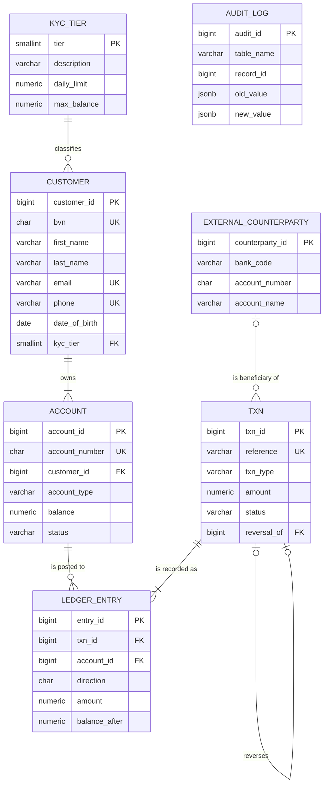

# Portfolio 1: Database Design and Modelling

Database design and modelling will show entity relationships, cardinality and relational schema. I will show the primary keys and constraints for the various tables and perform normalisation through the process.

The continuous assessment for advanced database systems(MIIT 8103). I am Habeeblai Adedayo Adelanwa. I am choosing the case study/ogranisation type of Bank/Fintech Platform. I work in the finance space and it is familiar territory for me.

## 1. Selected case study

| Item | Description |
|---|---|
| **Organisation** | KoboLedger: a *simulated* Nigerian digital-wallet fintech (not a real company; all data is synthetic) |
| **Nature of business** | Mobile wallet that lets customers hold Naira, receive deposits, and send instant transfers to other wallets and bank accounts |
| **Database users** | Customers (via mobile app), customer-support staff, compliance/audit officers, finance/reconciliation team, DBA |
| **Major data stored** | Customers and KYC tier, accounts and balances, transactions, double-entry ledger entries, audit trail |
| **Key operations** | Open account, deposit, withdraw, transfer funds, reverse failed transfers, enforce KYC daily limits, generate statements, audit balances |

The continuous assessment for advanced database systems(MIIT 8103). I am Habeeblai Adedayo Adelanwa. I am choosing the case study/ogranisation type of Bank/Fintech Platform. I work in the finance space and it is familiar territory for me.

The DayoKoboLedger needs strong consistency for money, high read volume for statements, and semi-structured data for audit/events.

## 2. Entity–Relationship diagram



**Relationships and cardinality**

| Relationship | Cardinality | Business rule |
|---|---|---|
| KYC_TIER → CUSTOMER | 1 : N | Every customer is on exactly one tier; a tier has many customers |
| CUSTOMER → ACCOUNT | 1 : N (mandatory) | A customer owns one or more accounts; an account has exactly one owner |
| TXN ↔ ACCOUNT | M : N, resolved by **LEDGER_ENTRY** | A transfer touches 2 accounts; an account has many transactions |
| TXN → TXN | 1 : 0..1 (recursive) | A REVERSAL undoes exactly one earlier transaction, at most once |
| EXTERNAL_COUNTERPARTY → TXN | 1 : N (optional) | An inter-bank transfer names one beneficiary at another bank; internal transfers have none |

**Inter-bank transfers:** an account at another bank is never in ACCOUNT, so it cannot be a ledger leg. Instead, the outward transfer debits the customer and credits KoboLedger's own *NIP Outward Settlement* GL account, and the beneficiary's details are kept in EXTERNAL_COUNTERPARTY. Every ledger row still references a real account, so referential integrity holds and debits still equal credits.

## 3. Relational schema (summary)

- KYC_TIER(**tier**, description, daily_limit, max_balance)
- CUSTOMER(**customer_id**, bvn*, first_name, last_name, email*, phone*, date_of_birth, *kyc_tier* → KYC_TIER)
- ACCOUNT(**account_id**, account_number*, *customer_id* → CUSTOMER, account_type, currency, balance, status, opened_at)
- TXN(**txn_id**, reference*, txn_type, amount, status, narration, *reversal_of* → TXN, initiated_at)
- LEDGER_ENTRY(**entry_id**, *txn_id* → TXN, *account_id* → ACCOUNT, direction, amount, balance_after, created_at)
- AUDIT_LOG(**audit_id**, table_name, record_id, action, changed_by, changed_at, old_value, new_value)

**Bold** = primary key, \* = alternate (candidate) key enforced with UNIQUE, *italic →* = foreign key. Full DDL: [`01_schema.sql`](01_schema.sql)

## 4. Keys and constraints

| Constraint type | Example | Protects against |
|---|---|---|
| Primary key (surrogate, IDENTITY) | `customer_id` | Duplicate rows; gives a stable key that never changes if a phone/email changes |
| Candidate / UNIQUE keys | `bvn`, `email`, `phone`, `account_number`, `reference` | Duplicate customers; double-posting the same transaction reference |
| Foreign keys | `account.customer_id → customer` | Orphan accounts (referential integrity) |
| `ON DELETE RESTRICT` | customer → account | Deleting a customer who still holds money |
| Domain CHECK | `balance >= 0`, `amount > 0`, `bvn ~ '^[0-9]{11}$'` | Overdrafts, zero/negative transfers, malformed BVNs |
| Enumerated CHECK | `account_type IN (...)`, `status IN (...)` | Invalid states |
| Table-level CHECK | `reversal_has_parent` | A REVERSAL without the transaction it reverses |
| Business-rule CHECK | `date_of_birth <= today − 18 years` | Under-age account opening |

**Evidence:** `03_constraint_tests.sql` attempts 7 illegal operations; all 7 are rejected by the DBMS. See `screenshots/constraint-tests.png`.

## 5. Normalisation

### Starting point: unnormalised transfer report (UNF)

This is how a finance team might keep transfers in a spreadsheet:

| ref | date | amount | sender_name | sender_phone | sender_acct | sender_tier | sender_daily_limit | receiver_name | receiver_acct | receiver_tier |
|---|---|---|---|---|---|---|---|---|---|---|
| KL-0001 | 12/11 | 5000 | Ada Okafor | +234...01 | 0123456781 | 3 | 5,000,000 | Musa Bello | 0123456783 | 2 |
| KL-0002 | 12/11 | 2000 | Ada Okafor | +234...01 | 0123456781 | 3 | 5,000,000 | Tolu Adeyemi | 0123456784 | 1 |

**Anomalies:**
- *Update anomaly:* if Ada changes her phone, every row she appears in must be updated.
- *Insertion anomaly:* a new customer cannot be recorded until they make a transfer.
- *Deletion anomaly:* deleting Tolu's only transfer deletes the fact that Tolu exists.

### 1NF: atomic values, no repeating groups, a key
Split `sender_name` into first/last name. Treat "sender" and "receiver" as **repeating groups** of the same thing (an account taking part in a transaction), so restructure as one row per (ref, account): `(ref, acct_number, direction, date, amount, name, phone, tier, daily_limit)`, with composite key **(ref, acct_number)**.

### 2NF: remove partial dependencies
With key (ref, acct_number):
- `ref → date, amount` depends on only *part* of the key → move to **TXN**
- `acct_number → name, phone, tier, daily_limit` depends on only *part* of the key → move to **ACCOUNT/CUSTOMER**
- What remains, `(ref, acct_number) → direction`, is **LEDGER_ENTRY**

### 3NF: remove transitive dependencies
- `account_number → customer_id → name, phone`: the customer facts depend on the account only *through* the customer → split **CUSTOMER** from **ACCOUNT** (this also lets one customer own several accounts).
- `customer_id → tier → daily_limit`: the limit depends on the tier, not the customer → split **KYC_TIER**.

### BCNF check
For every functional dependency X → Y in each table, X is a candidate key:
- CUSTOMER: `customer_id`, `bvn`, `email`, `phone` each determine the whole row, and **all are candidate keys** (declared UNIQUE). ✔
- ACCOUNT: `account_id`, `account_number` are both candidate keys. ✔
- TXN, LEDGER_ENTRY, KYC_TIER: the only determinants are their keys. ✔

### Deliberate denormalisation
`account.balance` is derivable from `SUM(ledger_entry)`, so storing it is technically redundant. It is kept because the balance is read on *every* transfer and statement, and summing millions of ledger rows each time would be too slow. The risk (balance and ledger disagreeing) is controlled by the `CHECK (balance >= 0)` constraint and by updating both only inside one ACID transaction (Portfolio 3), with a reconciliation query to prove they still match.


## 6. How to run

```bash
createdb koboledger
psql -d koboledger -f 01_schema.sql
psql -d koboledger -f 02_seed.sql
psql -d koboledger -f 03_constraint_tests.sql   # every statement should error
```

Tested on PostgreSQL 16.
