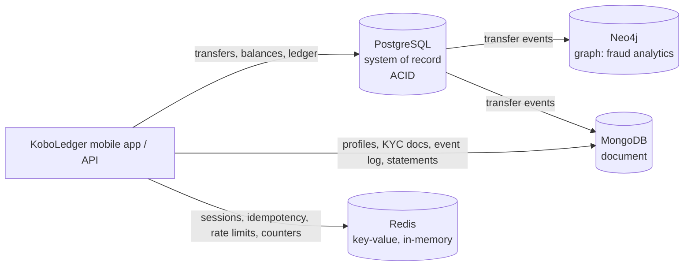

# Portfolio 4: NoSQL and Advanced Data Models

> ✏️ = write in your own words. Replace sample outputs with yours and add screenshots to `screenshots/`.

## 1. Objective

Model KoboLedger data that does **not** fit the relational ledger well, in the NoSQL family that suits it, and justify each choice. The money itself stays in PostgreSQL: this portfolio argues for **polyglot persistence** (each kind of data in the database built for it), not for replacing SQL.

## 2. Architecture: which data lives where



| Data | Store | Why it fits | Why not PostgreSQL alone |
|---|---|---|---|
| Ledger, balances, transfers | **PostgreSQL** | Needs ACID, constraints and joins (Portfolios 1–3) | — it *is* the right tool |
| Customer profile + KYC documents + devices | **MongoDB** | Shape grows with KYC tier; read together as one unit ("customer 360") | 4+ tables and joins for one screen; schema changes need migrations |
| Transaction events from NIP / CARD / USSD | **MongoDB** | Polymorphic: each channel has different fields | One table = many NULL columns; one table per channel = UNION queries |
| Monthly statements (read model) | **MongoDB** (bucket pattern) | One document = one statement page = one read | Fine in SQL too; a convenient denormalised view |
| Sessions, idempotency keys, OTP counters | **Redis** | Sub-millisecond, automatic expiry (TTL), atomic counters | Expiry needs cleanup jobs; every app request would hit the main DB |
| Who-is-connected-to-whom (fraud) | **Neo4j** | Relationships are first-class; multi-hop queries are natural | Recursive CTEs: complex and slow as hop count grows |
| Long transaction history at very high write rates | **Cassandra** (design only, §6) | Partitioned, write-optimised, linear scale-out | Single-node write ceiling |

## 3. Document model: MongoDB

**Files:** `mongodb/01_setup_and_validation.js`, `02_seed_data.js`, `03_queries.js` · **Data:** 2,000 customers (same `customer_id`s as PostgreSQL), 60,000 transaction events

### 3.1 Modelling decisions: embed or reference?

| Relationship | Decision | Reason |
|---|---|---|
| Customer → KYC documents, devices, address | **Embed** | Always read with the customer; small, bounded (a handful per customer) |
| Customer → accounts (summary) | **Embed** (number + type only) | Needed on the profile screen; the authoritative account stays in PostgreSQL |
| Customer → transaction events | **Reference** (`customer_id`, `account_number`) | Unbounded growth: thousands per customer would breach the 16 MB document limit |
| Account month → entries | **Embed** in a bucket document | Bounded (one month); read together as a statement page |

Rule used: **embed what is read together and bounded; reference what grows without limit or is shared.**

### 3.2 Evidence

| # | Demonstrates | Result (✏️ replace with yours) |
|---|---|---|
| Setup | `$jsonSchema` validation, the NoSQL equivalent of CHECK constraints | 4 bad documents rejected, each naming the broken rule (`bvn: pattern`, `amount: bsonType`, `channel: enum`…) |
| M1 | Customer 360 in one read | Profile, KYC docs, accounts and devices from one `findOne` |
| M2 | Polymorphic query | `card.merchant.mcc` queried on CARD events only; no NULL columns |
| M3 | Schema evolution | KYC upgrade adds an `address` object and pushes documents/devices; no `ALTER TABLE`, atomic on one document |
| M4 | Aggregation pipeline | Monthly volume by channel (`$match` → `$group` → `$sort`), cf. Portfolio 2 Q6 |
| M5 | Indexing | **COLLSCAN, 60,000 docs examined, 22 ms → IXSCAN, 20 docs, 1 ms** with `{account_number: 1, ts: -1}` |
| M6 | Bucket pattern | 22,781 monthly statement documents built with `$group` + `$push` + `$merge` |
| M7 | Single-document atomicity | `$push` + `$inc` on one bucket in one atomic update |

**M5 and the ESR rule:** MongoDB's guideline for compound indexes is **E**quality → **S**ort → **R**ange, the same principle as Portfolio 2's "equality column first, then the sort/range column".

**Money:** stored as `Decimal128`, and the validator rejects doubles, for the same reason Portfolio 1 used `NUMERIC` instead of `FLOAT`.

## 4. Key-value model: Redis

**File:** `redis/redis_demo.redis` (run with `redis-cli`)

| # | Pattern | KoboLedger use | Key commands |
|---|---|---|---|
| R1 | Expiring session | Login token valid 15 min | `SET … EX 900`, `TTL` |
| R2 | **Idempotency key** | Customer double-taps *Send*: second request rejected before it reaches PostgreSQL | `SET … NX EX 86400` |
| R3 | Atomic counter | Today's spend for the KYC limit check: cache in front of Portfolio 2's Q2 | `INCRBY`, `EXPIRE … NX` |
| R4 | Rate limiting | Lock OTP after 3 wrong attempts in 5 minutes | `INCR`, `EXPIRE` |
| R5 | Hash | Cached account summary for the home screen | `HSET`, `HINCRBY`, `HGETALL` |
| R6 | Sorted set | Real-time top merchants by spend | `ZINCRBY`, `ZREVRANGE … WITHSCORES` |

R2 adds a second layer of protection to Portfolio 3's row locks: Redis stops the *duplicate request*; PostgreSQL stops the *double spend*.

**Limits:** Redis keeps data in memory and has no decimal type, so amounts are stored in **kobo (integers)**. Persistence (RDB snapshots / AOF log) is configurable but weaker than PostgreSQL's WAL, so Redis is never the system of record for money: every value in it can be rebuilt or safely lost.

## 5. Graph model: Neo4j

**File:** `neo4j/fraud_graph.cypher` (Neo4j Aura Free or Desktop)

| # | Question | Pattern |
|---|---|---|
| G1 | Which phones are used by several "different" customers? | `(Device)<-[:USED_DEVICE]-(Customer)` with count > 1 |
| G2 | Who is within 2 transfers of a flagged customer? | Variable-length path `[:SENT*1..2]` |
| G3 | Is money round-tripping within 24 hours? | Cycle `(a)-[:SENT*3..5]->(a)` with a time filter |
| G4 | What is the shortest money trail between two customers? | `shortestPath(…[:SENT*..6]…)` |

**Why a graph:** G3 in SQL needs a recursive CTE that joins `ledger_entry` to itself once per hop, tracks visited accounts to avoid infinite loops, and gets slower with each extra hop. In a graph database each relationship is stored as a direct pointer ("index-free adjacency"), so following a hop costs the same however large the dataset. The query reads like the fraud pattern it describes.

✏️ Screenshot the graph view: the dev-X triangle and the 103→104→105→103 ring are visible at a glance.

## 6. Column-family model: Cassandra (design only)

Not implemented; included to cover the fourth NoSQL family and to prepare Portfolio 5.

```sql
CREATE TABLE transactions_by_account (
    account_number text,
    month          text,          -- e.g. '2026-11'
    ts             timestamp,
    reference      text,
    channel        text,
    direction      text,
    amount         decimal,
    PRIMARY KEY ((account_number, month), ts, reference)
) WITH CLUSTERING ORDER BY (ts DESC, reference ASC);

-- the one query this table is designed for:
SELECT * FROM transactions_by_account
WHERE account_number = '1000000105' AND month = '2026-11' LIMIT 20;
```

- **Query-first design:** in Cassandra you design one table per query, not per entity, and duplicate data freely.
- **Partition key** `(account_number, month)` spreads data evenly across nodes and keeps each partition bounded. This is the same bucketing idea as M6.
- **Clustering key** `ts DESC` stores rows already sorted newest-first, so the statement query is a single sequential read.
- **Tunable consistency:** each query chooses `ONE`, `QUORUM` or `ALL` replicas, trading consistency against availability (CAP, Portfolio 5).

## 7. Trade-offs and CAP

| Store | Consistency model | CAP leaning (when partitioned) | Main risk for KoboLedger |
|---|---|---|---|
| PostgreSQL | ACID, strong | CP | Scaling writes beyond one primary |
| MongoDB | Strong on the primary; tunable read/write concerns | CP (by default) | Duplicated data drifting out of sync; multi-document transactions need a replica set |
| Redis | Single-threaded atomic ops; async replication | AP-leaning | Data loss on crash between persistence points |
| Neo4j | ACID on a single instance | CP | Must be fed from the ledger; can lag behind it |
| Cassandra | Eventual / tunable | AP | Stale reads at low consistency levels |

**The cost of polyglot persistence:** more systems to run, secure and back up; data copied between stores can drift, so PostgreSQL stays the single source of truth and the other stores are fed from it and can be rebuilt.

## 8. How to run

| Database | Option A: Docker | Option B: no Docker |
|---|---|---|
| MongoDB | `docker run -d --name kobo-mongo -p 27017:27017 mongo:8` | MongoDB Community Server + **mongosh** installers, or a free **Atlas M0** cluster |
| Redis | `docker run -d --name kobo-redis -p 6379:6379 redis:7` | Free Redis Cloud database + Redis Insight (has a CLI) |
| Neo4j | — | Free **Neo4j Aura** instance (runs in the browser) |

```bash
cd mongodb
mongosh "mongodb://localhost:27017" --file 01_setup_and_validation.js > ../results/mongodb_setup.txt
mongosh "mongodb://localhost:27017" --file 02_seed_data.js           > ../results/mongodb_seed.txt
mongosh "mongodb://localhost:27017" --file 03_queries.js             > ../results/mongodb_queries.txt
```
Redis, Windows **PowerShell**: `Get-Content redis\redis_demo.redis | docker exec -i kobo-redis redis-cli > results\redis_demo.txt` (Command Prompt: `docker exec -i kobo-redis redis-cli < redis\redis_demo.redis`). Piped output prints `(nil)` as an empty line.

Tested with MongoDB 8.0 (mongosh 2.3) and Redis 7.0.

## 9. Reflection
✏️ *3–5 sentences: when would you NOT use NoSQL for a fintech? Which store would you add first in a real system, and why?*
