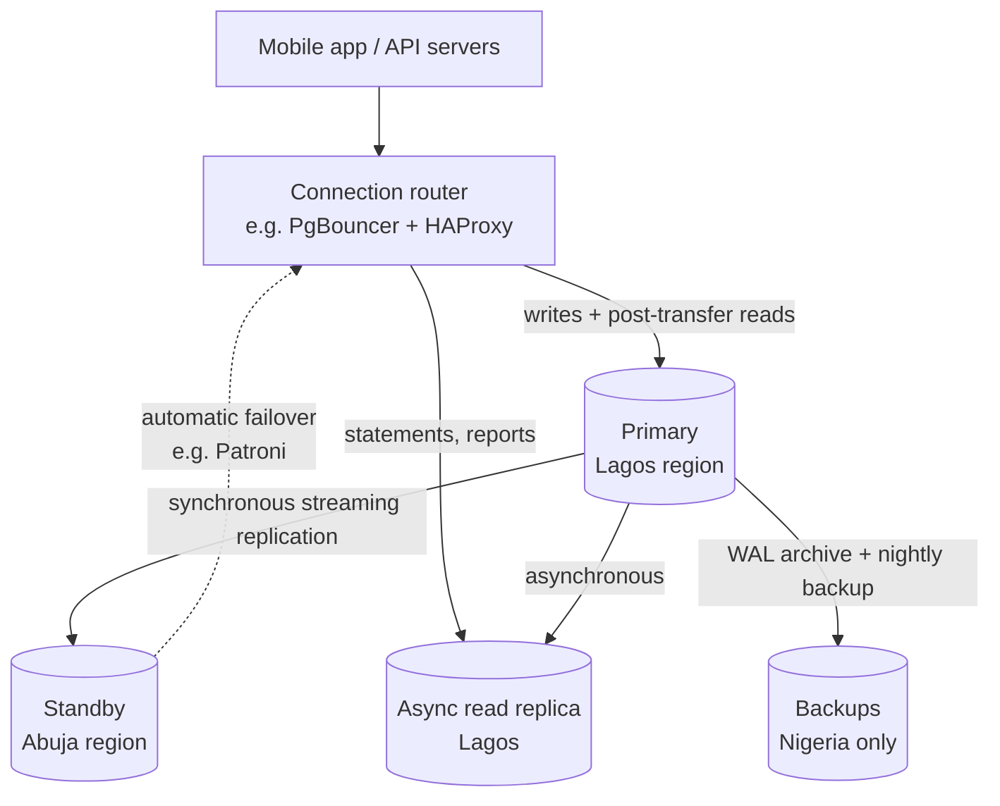

# Portfolio 5: Distributed and Cloud Database (design discussion)

## 1. Summary

KoboLedger's ledger is designed as a **CP** system: it chooses consistency over availability when the network splits. It runs as PostgreSQL replicated across **two Nigerian regions**. Two forces drive the design: correctness of money (Portfolios 1 and 3) and the **CBN data localisation rules effective 1 January 2027**, which keep every copy of payment data, including backups and DR, inside Nigeria.

## 2. Target architecture

## 3. Design decisions

### 3.1 Replication
- **Synchronous standby in a second Nigerian region (Abuja).** A transfer COMMIT returns only after the standby has the WAL record (`synchronous_commit = on`, `synchronous_standby_names`). If Lagos is lost, no committed transfer is lost: **RPO = 0**.
- **Asynchronous read replicas** serve statements and reports (Portfolio 2's Q1 and Q6). They may lag by milliseconds to seconds, which is acceptable for history but not for a balance shown straight after a transfer.
- **Trade-off:** synchronous replication adds the Lagos–Abuja round trip (a few milliseconds) to every commit. That is acceptable for money and not needed for read replicas.

### 3.2 Availability and failover
- A failover manager (e.g. **Patroni**, with a consensus store such as etcd) promotes the standby automatically if the primary fails. Target **RTO under 1 minute**.
- The connection router sends traffic to whichever node is primary, so the application doesn't change.
- **Split-brain protection:** a node becomes primary only while it holds the leader lock in the consensus store, so two primaries can never accept transfers at once.

### 3.3 Consistency and CAP
| Component | Choice during a network partition | Why |
|---|---|---|
| Ledger (PostgreSQL primary + sync standby) | **C**: refuse transfers rather than risk divergence | A double spend is worse than a short outage |
| Statements (async replicas) | **A**: serve slightly stale data | History seconds old is acceptable |
| Redis sessions/caches (Portfolio 4) | **A** | Can be rebuilt from PostgreSQL |

**Read-your-writes problem:** after a transfer, the customer's next balance read must not come from a lagging replica, or the money appears not to have moved. Solution: route balance reads, and any read within N seconds of a write by that customer, to the primary. Everything else can use replicas.

### 3.4 Sharding (when one primary is no longer enough)
- **Shard key: hash of `customer_id`** (e.g. with the Citus extension). All of a customer's accounts, ledger entries and KYC data land on the same shard, so most queries and the KYC limit check stay on one node.
- **Why not shard by date or by account_id?** Date puts all of today's writes on one hot shard. account_id splits one customer's accounts across nodes and makes the KYC check a cross-shard query.
- **Cross-shard transfers** (Ada on shard 1 pays Musa on shard 2) cannot use a single local transaction:
  - **Two-phase commit (2PC):** atomic, but a coordinator failure can leave both shards blocked holding locks.
  - **Saga:** debit on shard 1, then credit on shard 2. If the credit fails, a **compensating transaction** reverses the debit, which is exactly Portfolio 3's `reverse_transfer()`. Eventually consistent, but never blocks.
  - Choice: ✏️ argue which you prefer and why (hint: most payment systems use sagas with an internal settlement account, like the NIP GL in Portfolio 1).

### 3.5 Cloud deployment and Nigerian regulation
- **CBN Data Localisation Circular (15 June 2026), effective 1 January 2027:** payment transaction data generated in Nigeria must be stored and managed in Nigeria. The CBN FAQ (Q7) states that backups, disaster recovery sites, archives and replicated databases must all be located in Nigeria. Cloud providers may host the data (Q5), but the institution stays fully accountable, and the provider must be NCC-certified and NITDA-supervised (Q12).
  - **Design consequence:** the common "DR region in Europe" pattern is **not allowed**. Both regions, all replicas and all backups are in Nigeria.
- **Nigeria Data Protection Act 2023, Part VIII (ss. 41–43):** personal data may leave Nigeria only with an adequate level of protection (an adequacy decision or an approved transfer instrument), or under a section 43 basis such as consent or contractual necessity, and the basis must be recorded.
- **Managed vs self-hosted:** a managed PostgreSQL service in a Nigerian region gives automated backups, patching and failover, but less control over configuration. Self-hosted Patroni on Nigerian data centres gives full control at a higher operational cost. ✏️ State your choice.

## 4. Optional setup evidence (if time allows)
A minimal two-node streaming-replication setup with Docker would demonstrate replication lag (`pg_stat_replication`), read-only replicas, and promotion with `pg_promote()`. Not completed for this submission.

## 5. Sources
- Central Bank of Nigeria, [FAQ on the Data Localisation Circular issued on 15 June 2026](https://www.cbn.gov.ng/Out/2026/CCD/FAQ%20Data%20Localisation%20Updated%2004-11-2026.pdf) (updated 4 Nov 2026), Q5, Q7, Q12, Q20.
- Nigeria Data Protection Act 2023, Part VIII, ss. 41–43.
- PostgreSQL 16 Documentation: High Availability, Load Balancing, and Replication.
